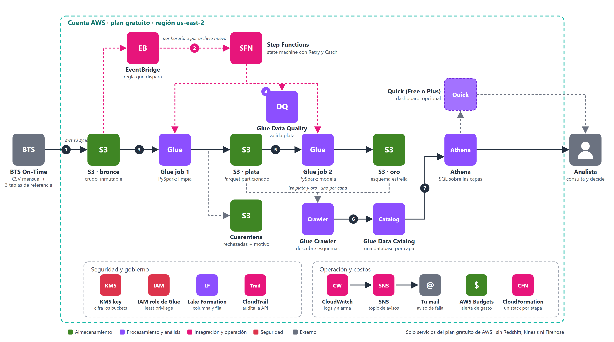
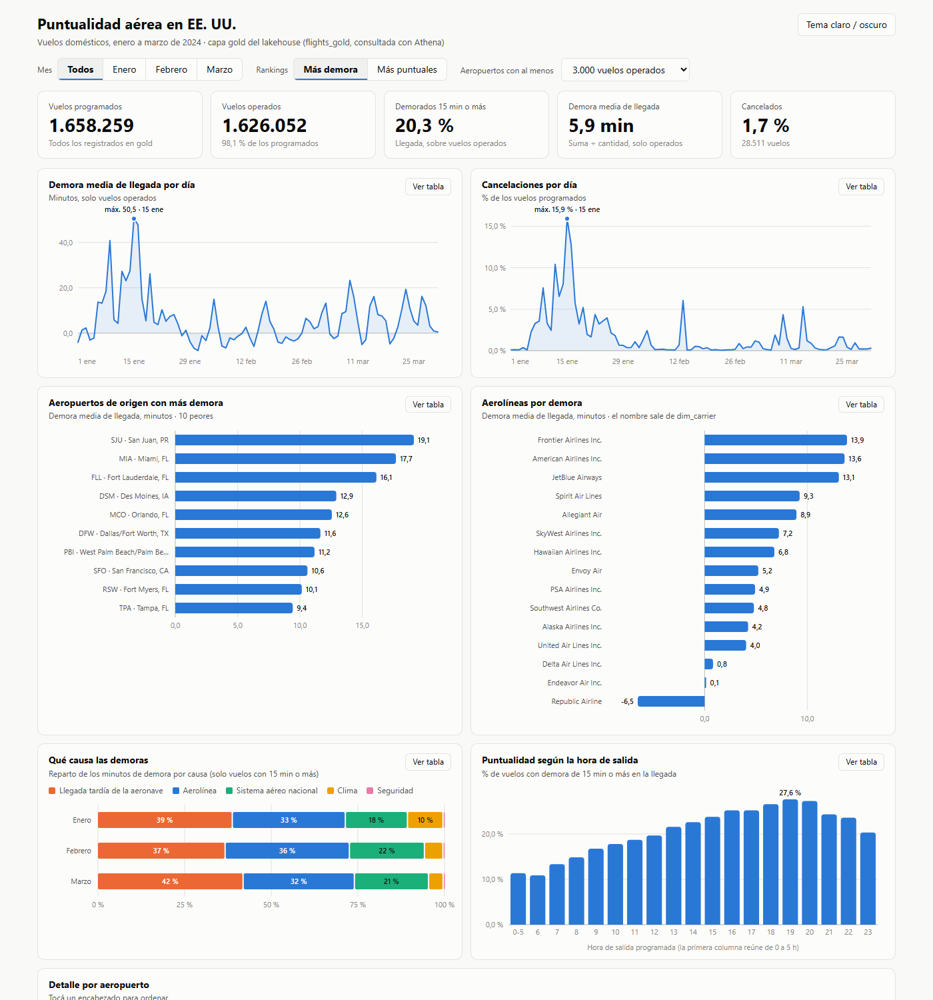

# Lakehouse de puntualidad aérea de EE. UU. en AWS

Pipeline de datos de punta a punta sobre los vuelos domésticos de EE. UU. (BTS On-Time Performance), construido en AWS solo con servicios del plan gratuito.



## Para qué sirve

Es un caso ficticio con datos públicos reales: el equipo de operaciones de una aerolínea quiere decidir con datos confiables.

1. **¿Qué aeropuertos y aerolíneas concentran más demoras y cancelaciones?** Para saber dónde reforzar la operación.
2. **¿Qué causas explican las demoras?** Para elegir entre invertir en tripulación y mantenimiento o coordinar con el control aéreo.
3. **¿Qué rutas y franjas horarias tienen peor puntualidad?** Para reprogramar vuelos.

El trabajo del pipeline es que esos números sean confiables: limpia lo que llega sucio, aparta lo rechazado con su motivo y modela los datos para que un analista los consulte sin tocar el dato crudo.

## Lo que ve el analista

Un dashboard HTML autocontenido, alimentado por consultas de Athena sobre la capa de oro ([abrir el archivo](docs/dashboard/dashboard-gold.html) en el navegador; no necesita internet). Filtra por mes, ordena por los más o los menos puntuales, y cada gráfico tiene su tabla equivalente.



## Cómo está armado

| Capa | Qué hace |
|---|---|
| Bronce | Guarda el CSV mensual tal como sale del zip |
| Plata | Datos limpios y tipados, en Parquet particionado |
| Cuarentena | Las filas rechazadas, con el motivo |
| Oro | Esquema estrella para el análisis |

Servicios: S3, KMS, IAM, Glue, Athena, Lake Formation, Step Functions, EventBridge, CloudWatch, SNS, CloudFormation y CloudTrail.

## Documentación

- [Plan completo](docs/PLAN.md): dataset, capas, modelo de gold y fases.
- [Bitácora](PROGRESO.md): en qué fase está y qué decisiones se tomaron.
- [Errores y aprendizajes](docs/ERRORES.md): qué salió mal, cómo se diagnosticó y qué se corrigió.
- [Decisiones de diseño](docs/DECISIONES.md): para qué se construyó, qué se decidió y por qué, con el número que respalda cada decisión y las alternativas descartadas.

## Requisitos

Es un proyecto personal de práctica, no un despliegue de un clic. La base (buckets, clave de KMS, roles, topic de SNS) se creó a mano en la consola, paso a paso, y está descrita en [PROGRESO.md](PROGRESO.md). Para reproducir algo de lo que sigue hace falta:

- Una cuenta de AWS con el plan gratuito, en `us-east-2`, y la CLI v2 con un perfil llamado `flights` (`aws login --profile flights`).
- Docker, para correr las pruebas con la imagen oficial de Glue 5.0.
- Python 3.11 y, en Windows, Git Bash.

Los nombres de los buckets llevan el ID de la cuenta; los scripts lo piden a AWS (`sts get-caller-identity`) y no lo tienen escrito.

## Qué se puede ejecutar

| Comando | Qué hace |
|---|---|
| `bash glue/run_tests.sh` | Las 68 pruebas de los dos jobs, en el contenedor de Glue 5.0. No usa AWS |
| `python -I scripts/download_data.py` | Baja los datos de BTS a `data/landing/` con la misma estructura que bronce (`--months 2024-03` para otro mes) |
| `python -I scripts/make_synthetic_bad_month.py` | Arma un mes **sintético** defectuoso (abril) que debe frenar la calidad de datos |
| `bash aws/scripts/up.sh` | Despliega el stack de orquestación (state machine, EventBridge, alarma) |
| `bash aws/scripts/lf-permisos.sh` | Aplica los permisos de Lake Formation de los dos analistas (`revocar` los quita) |
| `bash aws/scripts/demo-analistas.sh` | La misma consulta con tres identidades: seguridad por columna y por fila |
| `dq/run_eval.sh AAAA M` | Evalúa la calidad de un mes de plata |
| `bash aws/scripts/vivos.sh` | Lista todo lo que está encendido y podría cobrar (solo lectura) |
| `python scripts/dashboard_gold.py` | Consulta gold con Athena y regenera `docs/dashboard/dashboard-gold.html` (autocontenido, sin internet) |

Las consultas de Athena más usadas están en [sql/athena/consultas-clave.sql](sql/athena/consultas-clave.sql).

## Estructura

```
glue/              jobs de Glue (bronze_to_silver.py y silver_to_gold.py) y sus pruebas (tests/)
statemachine/      definición de la Step Function (pipeline.asl.json)
infra/             CloudFormation de la orquestación (orquestacion.yaml)
dq/                reglas de Glue Data Quality y script para evaluarlas
aws/scripts/       despliegue, permisos de Lake Formation, demo y listado de lo encendido
scripts/           descarga de datos, mes sintético y generador del dashboard
sql/athena/        consultas clave
docs/              plan, decisiones, errores, diagrama y dashboard
data/              datos descargados (no se suben a git)
```

## Los datos

Los datos no están en el repo: se bajan con `scripts/download_data.py` desde el sitio de BTS (Bureau of Transportation Statistics, gobierno de EE. UU.). No se pudo verificar un texto de licencia explícito en su página, así que conviene revisar los términos de uso antes de redistribuirlos.

## Licencia

El código y la documentación están bajo licencia MIT (ver [LICENSE](LICENSE)). Los datos de BTS no se incluyen y tienen sus propios términos de uso.

## Estado

Las fases 0 a 4 del plan gratuito están construidas y probadas de punta a punta (la 5, con Redshift y streaming, queda para un plan de pago): bronce, plata con cuarentena, calidad de datos, gold en esquema estrella, orquestación con reintentos y avisos, gobierno con Lake Formation (columna y fila), y auditoría con CloudTrail. Con enero, febrero y marzo de 2024 (1.658.259 vuelos). El dashboard de gold es un HTML local ([dashboard-gold.html](docs/dashboard/dashboard-gold.html)) y no Quick, porque Quick solo crea dashboards en su plan Enterprise, que no entra en la cuenta gratuita. Queda como mejora pasar la base (buckets, KMS, roles) a CloudFormation.
